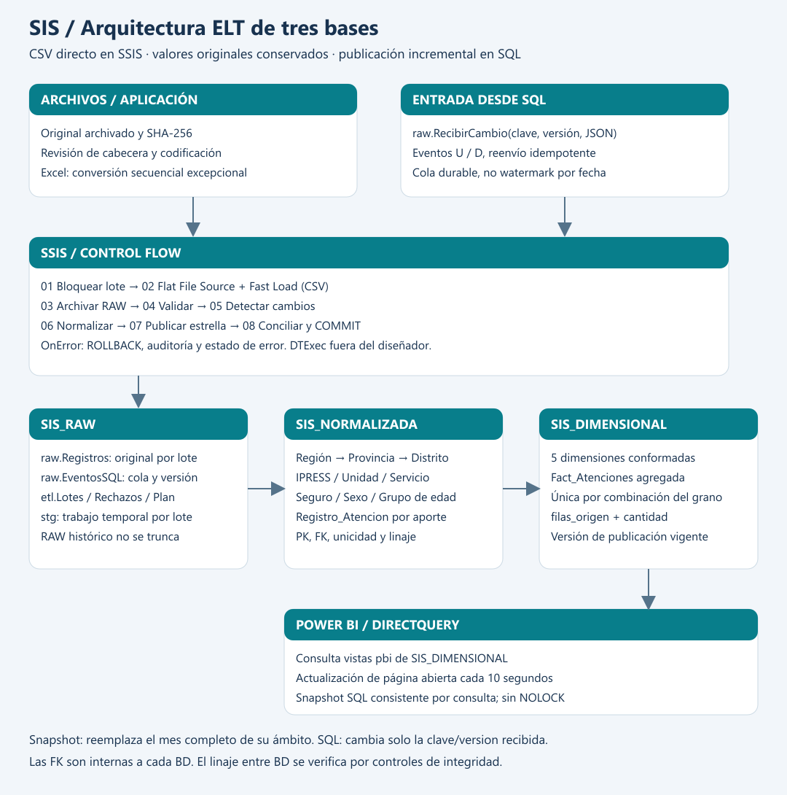

# Data Mart SIS: integración, análisis y planeamiento

Proyecto académico para integrar registros agregados de atenciones del Seguro Integral de Salud, conservar su trazabilidad y analizarlos con Power BI. Incluye tres libros de planeamiento estratégico.



## Arquitectura

```text
CSV / Excel y eventos SQL
             |
          SSIS / ELT
             |
SIS_RAW -> SIS_NORMALIZADA -> SIS_DIMENSIONAL -> Power BI
```

RAW conserva la entrada y auditoría. La capa normalizada organiza las entidades. La dimensional agrega hechos con cinco dimensiones: tiempo, IPRESS, servicio, seguro y demografía. Las atenciones no representan pacientes únicos.

## Contenido

| Carpeta o archivo | Contenido |
|---|---|
| `sql/` | Creación de bases lógicas, tablas, procedimientos, vistas y ejemplos incrementales |
| `motor/` | Paquete y proyecto SSIS, SQL de transformación y fuentes de compilación |
| `app/` | Centro local de cargas CSV/Excel y publicación de eventos SQL |
| `PowerBI/` | Proyecto PBIP, reporte y modelo semántico |
| `excel/` | Diagnóstico, formulación estratégica y Balanced Scorecard |
| `ejemplos/` | Casos sintéticos para demostrar aceptación, corrección y rechazo |
| `documentacion/` | Manual, diccionario, diagramas, alcance y fuentes |

## Requisitos

- Windows y Windows PowerShell 5.1.
- SQL Server compatible con el proyecto y SSIS **170 / SQL Server 2025** instalado. El paquete no es intercambiable automáticamente con otro runtime SSIS.
- Proveedor Microsoft OLE DB Driver 19 y permisos Windows para las bases del proyecto.
- Python 3.10 o superior con Tkinter. La lectura de Excel utiliza openpyxl.
- Power BI Desktop con soporte de proyectos PBIP. Visual Studio con extensión SSIS es opcional para editar la solución.

El perfil distribuido utiliza `localhost` y autenticación integrada de Windows. No se incluyen usuarios ni contraseñas. Para otro servidor deben ajustarse también las conexiones de la aplicación, SSIS y el modelo semántico.

## Instalación en un equipo nuevo

1. Clona o descarga este repositorio en una carpeta corta, por ejemplo `C:\Proyectos\SIS`.
2. Crea el entorno de Python desde esa carpeta:

   ```powershell
   py -3 -m venv .venv
   .\.venv\Scripts\python.exe -m pip install -r requirements.txt
   ```

3. Configura la ruta local de entrada del paquete:

   ```powershell
   powershell.exe -NoProfile -File .\Configurar_Proyecto.ps1
   ```

4. Ejecuta `RECONSTRUIR_BD.cmd`. Crea `SIS_RAW`, `SIS_NORMALIZADA` y `SIS_DIMENSIONAL` y aplica su estructura. Se requiere permiso de creación de bases. El inicializador rechaza bases existentes que no tengan la marca del proyecto y establece MAXDOP=1 dentro de las tres bases del proyecto.
5. Abre `INICIAR.cmd` y carga un caso sintético de `ejemplos`. La recreación de la estructura no carga millones de registros históricos.
6. Abre `PowerBI/SIS_Final_3BD.pbip` y conecta con autenticación Windows a `localhost`.

No se ejecuta la instalación ni la carga por clonar este repositorio. GitHub conserva los archivos; SQL Server y Power BI se ejecutan en el equipo que configure el proyecto.

## Demostración

| Acción | Archivo o control | Resultado esperado |
|---|---|---|
| Alta de un mes de prueba | `ejemplos/01_nuevo_2026_UTF8.csv` | Publicación confirmada de un caso pequeño |
| Corrección del mismo mes | `ejemplos/02_correccion_2026_UTF8.csv` | Sustitución dentro del ámbito y conciliación |
| Reenvío idéntico | El mismo archivo otra vez | Sin duplicación de la publicación |
| Rechazo | Ejemplos identificados como RECHAZADO | Incidencia registrada sin publicación parcial |
| Evento incremental SQL | `sql/91_Prueba_Incremental_EndToEnd.sql` | Entrada, publicación y verificación en las tres capas |

Los archivos representan snapshots completos de un ámbito de demostración. Los movimientos individuales se reciben por la interfaz SQL con clave y versión. Las pruebas modifican las bases del proyecto; deben ejecutarse en una instalación de demostración, no sobre otras bases de trabajo.

## Planeamiento y análisis

- `excel/01_Diagnostico_SIS.xlsx`: PESTEL, dependencias, EFE, EFI y capacidades.
- `excel/02_Estrategias_SIS.xlsx`: FODA, objetivos, matrices adaptadas y secuencia de decisión.
- `excel/03_Balanced_Scorecard_SIS.xlsx`: OCP, indicadores, mapa y responsables.

Los pesos y calificaciones son propuestas técnicas justificadas, no mediciones oficiales. Los OLP tienen un horizonte propuesto de 24 meses y el primer despliegue operativo es de 30–60 días desde la aprobación del plan. Las matrices comerciales que requieren variables no disponibles se presentan como adaptaciones explícitas, sin inventar rentabilidad o mercado.

## Datos, alcance y estado

La instalación de origen contiene extractos de 2018, 2019 y 2025 con meses diferentes, además de ensayos 2026. El repositorio no incluye el respaldo de esas bases ni sus datos masivos. Los conteos históricos, fuentes, limitaciones e incidencias pendientes se detallan en [Alcance y fuentes](documentacion/ALCANCE_Y_FUENTES.md).

El modelo Power BI usa DirectQuery y necesita SQL Server disponible. La hora de consulta no demuestra que una carga haya terminado. Las referencias heredadas 80/70/85% no deben presentarse como metas oficiales sin aprobación funcional.

## Documentación

- [Manual de usuario](documentacion/MANUAL_USUARIO.md)
- [Diccionario de datos](documentacion/DICCIONARIO_DATOS.json)
- [Diagrama completo](documentacion/DIAGRAMA_COMPLETO.html)
- [Preparación para GitHub](documentacion/CAMBIOS_PARA_GITHUB.md)

## Verificación sin conectar a SQL

```powershell
py -3 pruebas/verificar_entrega.py
```

Comprueba la entrega local, no ejecuta el ETL ni sustituye una prueba funcional de extremo a extremo. La preparación del repositorio no implica que las incidencias de carga documentadas estén resueltas.
